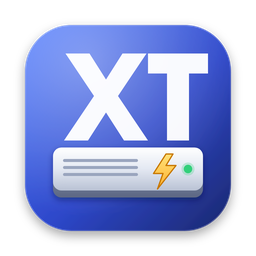

<p align="center"></p>

<h1 align="center">XT NTFS</h1>

<p align="center">Read-write NTFS for macOS, with a familiar volume-manager interface.<br>
Ghi dữ liệu vào ổ NTFS trên Mac, giao diện quen thuộc.</p>

<p align="center">
  <a href="https://github.com/xuanthanhtnt/xt-ntfs/releases/latest">Download</a> ·
  <a href="https://xuanthanhtnt.github.io/xt-ntfs/">Website</a> ·
  <a href="CHANGELOG.md">Changelog</a>
</p>

---

## What it does

Connect a hard drive, SSD or USB stick formatted on Windows and it mounts **read-write** in Finder, with no extra steps. The app manages volumes the way a disk utility does:

- Sidebar of volumes with read-write / read-only status, `read-only` and `nobrowse` badges, eject buttons
- **Mount / Unmount**, **Verify** (and repair), **Erase** (NTFS, ExFAT, FAT32, APFS, Mac OS Extended), **Startup**, rename
- Volume details: device, file system, driver, operating system, usage bar with file categories
- Per-volume options: Spotlight indexing, mount read-only, do not mount automatically
- Policies for hibernated Windows (Fast Startup) and volumes that were not unmounted cleanly
- Performance profiles (Compatible, Balanced, Turbo) and a built-in **benchmark** with history
- Menu bar extra, notifications, light/dark appearance, English and Vietnamese
- In-app updates (Sparkle 2, EdDSA-signed releases)

## Requirements

- macOS 13 Ventura or later (tested up to macOS 27), Apple silicon or Intel
- [macFUSE](https://macfuse.github.io/) with its system extension allowed. On Apple silicon, kernel extensions must be enabled in Startup Security Utility — the same requirement as commercial NTFS drivers that ship a kext.
- macOS 26 or later can skip the kernel extension: turn on macFUSE under System Settings → General → Login Items & Extensions → File System Extensions, and XT NTFS mounts through macFUSE's FSKit backend (slower than the kext). The backend can be chosen in Settings → General (Automatic / Kernel extension / FSKit).

## Install

1. Install macFUSE.
2. Download the DMG from [Releases](https://github.com/xuanthanhtnt/xt-ntfs/releases/latest) and drag **XT NTFS** to Applications.
3. The app is ad-hoc signed, not notarized: the first time, right-click → **Open** (or System Settings → Privacy & Security → **Open Anyway**).
4. Click **XT NTFS** at the bottom of the sidebar → **Install Engine…**

## How it works

```
 ┌───────────────┐   socket (JSON)   ┌──────────────────────────┐
 │ XT NTFS.app   │ ────────────────▶ │ xtntfsd (LaunchDaemon)   │
 │ SwiftUI, user │                   │ DiskArbitration watcher  │
 └───────────────┘                   │  - blocks read-only      │
                                     │    system mount of NTFS  │
                                     │  - mount / verify / erase│
                                     └────────────┬─────────────┘
                                                  │ spawns
                                     ┌────────────▼─────────────┐
                                     │ ntfs-3g + XT raw I/O     │──▶ /dev/rdiskXsY
                                     │ on macFUSE (kext/FSKit)  │
                                     └──────────────────────────┘
```

- **Helper** (`Sources/xtntfsd`): registers a DiskArbitration mount-approval callback, so macOS (or another driver) never mounts an NTFS volume read-only first; the helper mounts it with the engine instead. It also performs verify, repair, erase, rename and Spotlight changes, and reports events to the app.
- **Engine** (`engine/`): upstream [ntfs-3g](https://github.com/tuxera/ntfs-3g) plus `xt_rawio.c`, a device layer that
  - uses the raw device node (`/dev/rdisk…`) instead of the block node, avoiding the kernel buffer cache's small block-by-block transfers,
  - keeps every device request sector-aligned (read-modify-write at the edges, aligned bounce buffers),
  - sends large requests straight to the disk and gathers small metadata writes (MFT records, index blocks, bitmaps) in a write-back cache that is flushed in disk order by a background thread, on `fsync`, on unmount and before `fork()`.
- **FSKit backend**: FSKit mounts must be made by the logged-in user and do not survive `fork()`, so the helper hands the raw device to that user for the duration of the mount and runs ntfs-3g in the foreground in the user's session (`launchctl asuser`).
- **macFUSE options** per profile: large `iosize` (1 MiB / 8 MiB), `noatime`, `negative_vncache`, `noappledouble`, native extended attributes stored as NTFS streams.

### Testing

The I/O layer is tested on Linux in CI (`engine/tests`):

- `rawio_stress.c` — randomized reads/writes/seeks/syncs/forks against an in-memory reference image, with sector sizes 512/4096, tiny caches to force eviction, O_DIRECT, AddressSanitizer, UndefinedBehaviorSanitizer and ThreadSanitizer.
- `e2e_linux.sh` — formats an image, mounts it through FUSE with the XT engine in strict raw mode, copies thousands of files (including Vietnamese, Japanese and emoji names), renames, deletes, overwrites and truncates, then checks the volume with `ntfsfix` and re-reads every file with an unmodified ntfs-3g.

In that end-to-end test, copying 3,000 small files took 1.25 s with the XT cache and 7.21 s without it. Real-world speed depends on the disk and port; use the in-app benchmark to compare drivers on your own hardware.

## Build

```sh
# engine (macOS): needs autoconf automake libtool pkgconf libgcrypt (Homebrew)
engine/fetch-macfuse-sdk.sh /tmp/macfuse
MACFUSE_PREFIX=/tmp/macfuse engine/build-ntfs3g.sh build/engine

# app + DMG
scripts/build-app.sh build/engine/bin build
scripts/make-dmg.sh "build/XT NTFS.app" build/XT-NTFS.dmg
```

GitHub Actions (`.github/workflows/build.yml`) runs the engine tests, builds the universal engine and app on every push, publishes a release with the DMG and a signed `appcast.xml` whenever `VERSION` is new, and publishes the website from `docs/` to the `gh-pages` branch.

### Releasing

1. Add the Sparkle EdDSA private key (base64) as the repository secret `SPARKLE_ED_PRIVATE_KEY` (Settings → Secrets and variables → Actions). Its public half is `Resources/sparkle_public_key.txt`.
2. Bump `VERSION`, add a section to `CHANGELOG.md` and push to `main`. When CI finds no release for the new version it builds the DMG, creates the `vX.Y.Z` tag and release, and attaches the signed `appcast.xml`. (Pushing a `vX.Y.Z` tag works too.)

Without the secret, the release is still published but is not offered as an in-app update. It can be signed offline instead: download the DMG, run `SPARKLE_ED_PRIVATE_KEY=… scripts/make-appcast.py <dmg> <version> <build> <url> dist/appcast.xml` and commit `dist/appcast.xml`; CI checks the signature against the published DMG and attaches it to the release.

## Notes

- Always eject NTFS disks before unplugging them.
- Verify/repair uses `ntfsfix`: it fixes common problems and asks Windows to run a full `chkdsk` next time.
- BitLocker-encrypted volumes are not supported.
- Not affiliated with Microsoft or Paragon Software. NTFS is a trademark of Microsoft Corporation.

## License

GPL-2.0-or-later (see [LICENSE](LICENSE)). Includes ntfs-3g (GPL-2.0-or-later / LGPL-2.0-or-later, © Tuxera and contributors). macFUSE is not bundled.
